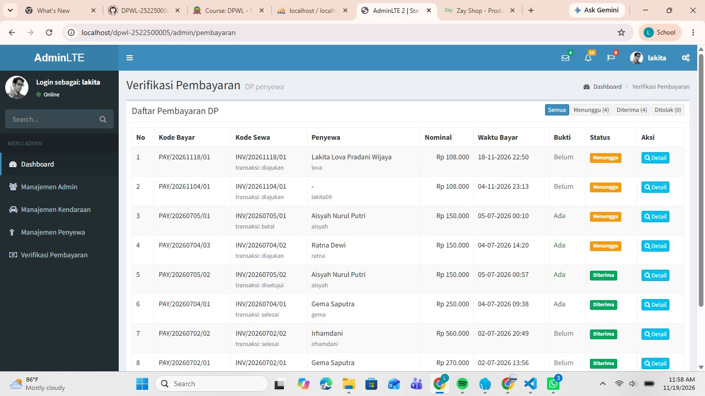
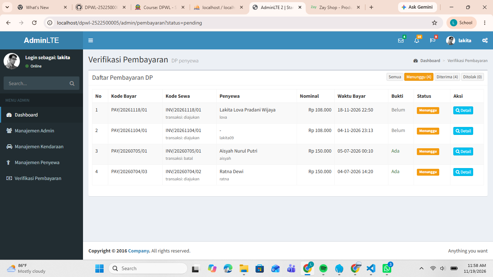
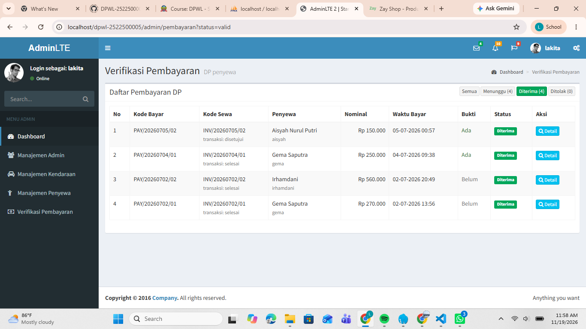

# pertemuan-09
Pembayaran Awal oleh Penyewa: Penyewa dapat melihat daftar tagihan pembayaran DP, memeriksa rincian sewa dan nominal DP (30% dari total transaksi sesuai basis data), serta mengunggah bukti transfer pembayaran.Verifikasi Pembayaran oleh Admin: Admin dapat memantau daftar pembayaran yang masuk, memeriksa detail transaksi beserta bukti transfer yang diunggah penyewa, dan memutuskan untuk menerima atau menolak pembayaran secara atomik dan konsisten.

Lokasi BerkasDeskripsi / Peran dalam Arsitektur MVCapplication/models/Pembayaran_model.phpMengelola kueri dan transaksi basis data (t_bayar, t_sewa, t_detail_sewa, t_mobil, t_penyewa) menggunakan prepared statement, penguncian baris (FOR UPDATE), serta pengecekan bentrok jadwal (anti-double booking).application/controllers/Pembayaran_controller.phpMenangani permintaan sisi penyewa: menampilkan daftar pembayaran (index), menampilkan form & memproses unggah bukti transfer (bayar), serta menyajikan gambar bukti pembayaran secara aman (bukti).application/controllers/Mpembayaran_controller.phpMenangani permintaan sisi admin: menampilkan daftar pembayaran & filter status (index), melihat detail verifikasi (detail), dan memproses keputusan verifikasi (verifikasi).application/helpers/csrf_helper.phpHelper keamanan untuk pembuatan (generate) dan validasi token CSRF (csrf_token(), csrf_field(), csrf_verify()) pada form transaksi dan pembayaran.application/views/pembayaran/index.phpTampilan daftar pembayaran DP milik penyewa yang sedang login beserta status verifikasinya.application/views/pembayaran/form.phpTampilan rincian transaksi, informasi nominal DP 30%, status pembayaran, pratinjau bukti sebelumnya, dan formulir unggah bukti transfer.application/views/admin/mpembayaran_view.phpTampilan halaman admin untuk memfilter, melihat daftar pembayaran DP, memeriksa gambar bukti transfer, dan tombol aksi terima/tolak pembayaran.uploads/bayar/.htaccessKonfigurasi keamanan server Apache untuk memblokir akses HTTP langsung ke direktori uploads/bayar/ sehingga berkas bukti hanya dapat diakses melalui kontroler terautentikasi.B. Berkas Lama yang DimodifikasiLokasi BerkasPerubahan yang Dilakukanapplication/config/routes.phpMenambahkan definisi routing untuk fitur pembayaran penyewa (/pembayaran, /pembayaran/bayar, /pembayaran/bukti) dan verifikasi admin (/admin/pembayaran, /admin/pembayaran/detail, /admin/pembayaran/verifikasi).application/views/katalog/navbar.phpMenambahkan menu navigasi Pembayaran pada bar navigasi publik/penyewa yang sedang login.application/views/templates/sidebar.phpMenambahkan menu navigasi Verifikasi Pembayaran pada sidebar halaman administrator.application/views/transaksi/konfirmasi.phpMenambahkan tombol/tautan pintasan menuju halaman pembayaran DP (/pembayaran/bayar?kode_sewa=...) setelah penyewa selesai melakukan checkout.

Integritas Data Pembayaran: Proses unggah bukti oleh penyewa melakukan UPDATE pada record t_bayar (kolom ft_byr dan tgl_wkt_byr) yang sudah terbentuk saat checkout, bukan membuat record baru.

Keamanan Nominal & Hak Akses: Nominal DP diambil langsung dari kolom nominal pada tabel t_bayar (30% dari total transaksi) dan tidak dapat dimanipulasi melalui formulir. Penyewa hanya dapat melihat dan mengunggah bukti untuk transaksi miliknya sendiri.

Validasi isi berkas menggunakan finfo (MIME type image/jpeg, image/png, image/webp) dan getimagesize(), serta penamaan ulang berkas secara acak/aman (bayar_<timestamp>_<random>.ext).

Proteksi Berkas Bukti: Folder uploads/bayar/ dilindungi dengan .htaccess (Require all denied). Gambar bukti transfer ditampilkan melalui rute /pembayaran/bukti?kode_bayar=... yang memeriksa sesi pemilik transaksi atau sesi admin.

Transaksi Basis Data & Anti Double-Booking: Saat admin menyetujui pembayaran (valid), sistem menjalankan transaksi basis data (begin_transaction & commit) untuk memperbarui t_bayar.sttus_byr = 'valid', t_bayar.tgl_wkt_ver, dan t_sewa.status_sewa = 'disetujui', sekaligus memastikan unit mobil tidak bentrok dengan transaksi lain yang sudah disetujui pada rentang tanggal yang sama.

Pola PRG & CSRF: Seluruh aksi pengiriman form (POST) menerapkan validasi token CSRF dan pola Post-Redirect-Get (PRG) untuk mencegah pengiriman ulang formulir.

Persiapan Lingkungan:Pastikan web server lokal (Laragon / XAMPP) dengan PHP 8.4 dan layanan MySQL/MariaDB sudah berjalan.Pastikan folder proyek dpwl-2522500016 berada di dalam direktori web root (misalnya C:\laragon\www\dpwl-2522500005\) dan folder uploads/bayar/ memiliki izin tulis (write permission).Pastikan basis data sudah terimpor dengan tabel t_sewa, t_detail_sewa, t_bayar, t_mobil, t_penyewa, dan t_admin.Alur Pengujian Penyewa:Buka aplikasi di browser, lalu login sebagai Penyewa (/auth/login-penyewa).Pilih kendaraan di katalog, tambahkan ke keranjang, dan lakukan Checkout untuk menghasilkan transaksi dan tagihan DP 30%.Klik tombol Bayar DP Sekarang pada halaman konfirmasi atau buka menu Pembayaran di navbar (/pembayaran).Klik Bayar / Upload Bukti, pilih berkas gambar bukti transfer (.jpg/.png/.webp $\le$ 5 MB), lalu kirim formulir.Pastikan status pembayaran tetap pending hingga admin melakukan verifikasi.Alur Pengujian Admin:Login sebagai Admin (/login).Buka menu Verifikasi Pembayaran pada sidebar (/admin/pembayaran).Pilih salah satu pembayaran berstatus pending, klik Detail, dan periksa gambar bukti transfer yang muncul.Uji tombol Terima Pembayaran (status menjadi valid dan sewa disetujui) atau Tolak Pembayaran (status menjadi invalid dan sewa ditolak).

### 1. Halaman Verifikasi 

